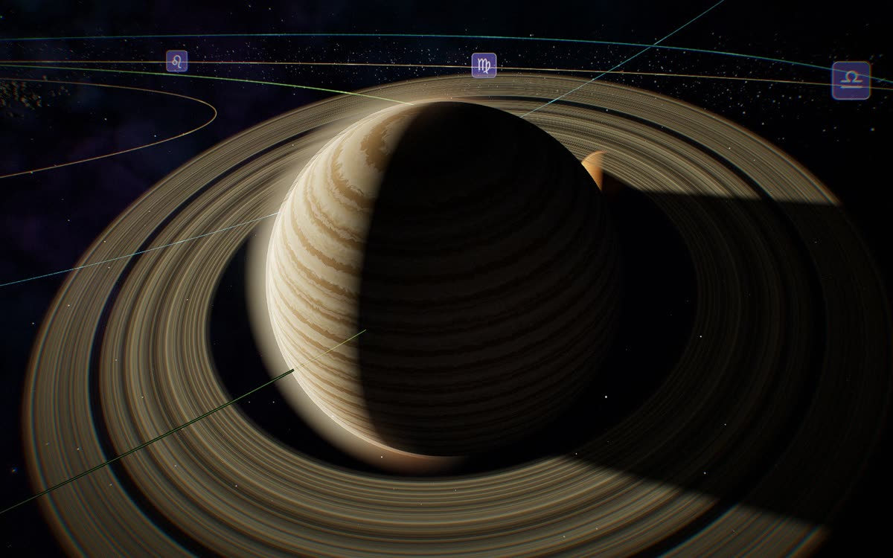
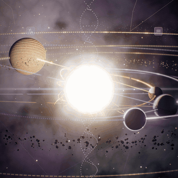
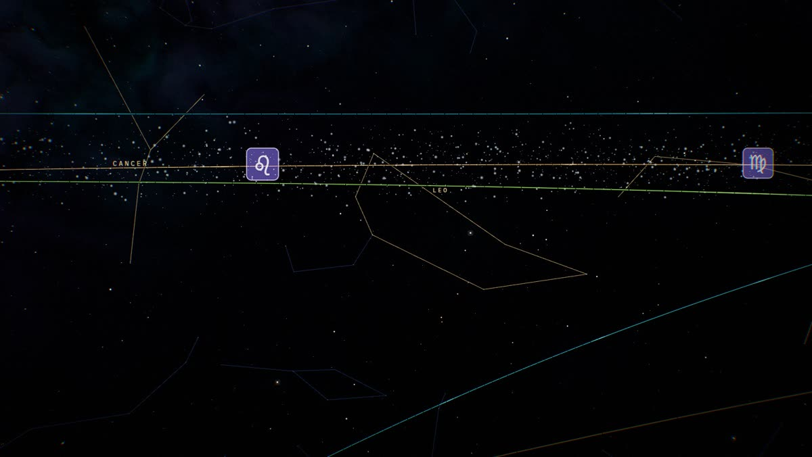
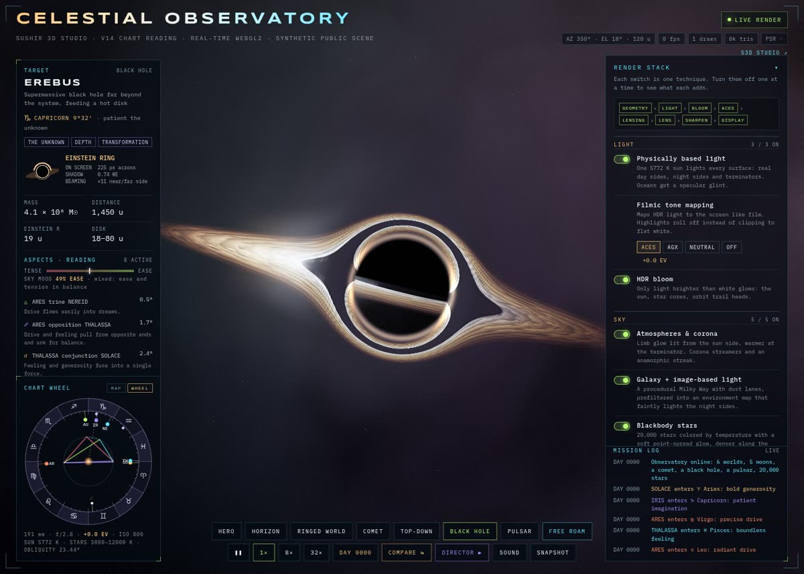
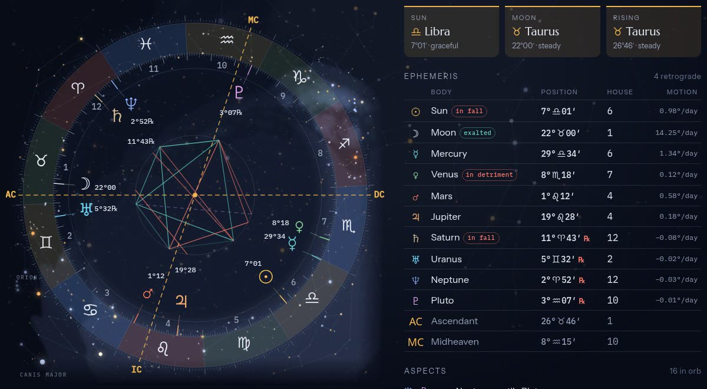

<a href="https://sushir-3d-studio.floot.app">
  <picture>
    <source media="(prefers-color-scheme: dark)" srcset="assets/banner-dark.svg">
    <source media="(prefers-color-scheme: light)" srcset="assets/banner-light.svg">
    
  </picture>
</a>

  <a href="https://sushir-3d-studio.floot.app"><b>Visit the live studio</b></a> &nbsp;·&nbsp;
  <a href="https://github.com/windingsky9-droid/Ssushhii/tree/main/portfolio">Portfolio</a> &nbsp;·&nbsp;
  <a href="https://github.com/windingsky9-droid/Ssushhii/issues/new?template=service-request.yml">Start a project</a>

**Python & API developer building useful integrations, dashboards, and interactive 3D demos.**
I'm open to junior, contract, and project-based work involving Flask, REST APIs, workflow automation, and browser-based visualization.

  
  
  
  
  
  
  
  
  

## Interactive 3D

<table>
  <tr>
    <td width="60%" valign="top">
      
    </td>
    <td valign="top">
      <h3>Celestial Observatory</h3>
      A real-time WebGL2 scene built on three.js. Six procedural worlds are lit by one 5772&nbsp;K sun, with HDR bloom, filmic tone mapping, and 3,232 real stars behind them.
      <ul>
        <li><b>EREBUS</b>, a black hole whose lens bends light into a true Einstein ring</li>
        <li>A pulsar sweeping its beams past the camera</li>
        <li>A chart wheel that reads each planet's zodiac sign live</li>
        <li>Frame-exact film capture for trailers</li>
      </ul>
    </td>
  </tr>
</table>

  
  &nbsp;
  
  &nbsp;
  

### [Sky Wheel](https://github.com/windingsky9-droid/Ssushhii/blob/claude/peaceful-carson-ce2p6a/portfolio/demos/sky-wheel.html)

A chart of the real sky for any moment from 1800 to 2050, running entirely in the browser. It shows the Sun, Moon and planets through Pluto with signs, retrogrades and aspects, set against 3,232 real stars and the constellation figures. It also includes a Compare mode for two moments and a 2400×3200 print poster.

Positions were checked against PyEphem at 240 dates:

| Body | RMS error |
|---|---|
| Sun | 0.006° |
| Moon | 0.028° |
| Every planet | under 0.1° |

 

### [Sushir Halo Tactical Command Center](https://github.com/windingsky9-droid/Ssushhii/tree/main/showcase)
An interactive Three.js tactical visualization with camera controls, replay analysis, route overlays, and a cinematic Director Mode. Tactical values are modeled demo values, not official Halo telemetry.

## APIs and dashboards

### [Market Observatory](https://github.com/windingsky9-droid/Ssushhii)
A Flask research dashboard with a provider boundary, deterministic demo data, JSON endpoints, and automated tests. Demo mode runs without paid API credentials.

- 15 existing tests passed during cloud setup.
- Live health, ticker research, invalid-input, and pricing checks passed.
- Desktop and mobile browser flows were verified.
- Live data providers and payment integrations are optional; the verified demo uses synthetic data.

## What I can help with

- Diagnose small Flask and REST endpoint issues.
- Connect documented APIs and handle errors clearly.
- Build focused dashboards and internal tools.
- Explore bounded AI/MCP integrations.
- Create browser-based visualization prototypes, from a chart to a full 3D scene.

## Start a conversation

[Open a service brief](https://github.com/windingsky9-droid/Ssushhii/issues/new?template=service-request.yml) with your goal, expected behavior, and relevant constraints. Please leave passwords and API keys out of public issues.

Small Flask/API fixes can start at **$40 USD**, subject to confirming the exact issue and scope first.
