<a href="https://sushir-3d-studio.floot.app">
  <picture>
    <source srcset="assets/hero.webp" type="image/webp">
    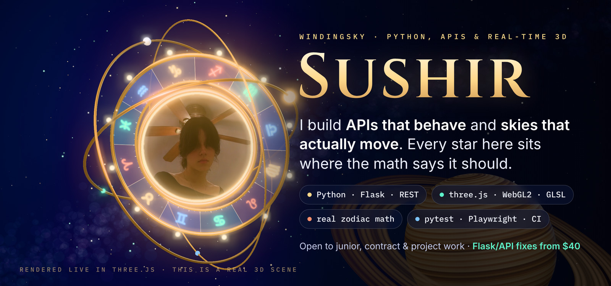
  </picture>
</a>

<p align="center">
  <a href="https://sushir-3d-studio.floot.app"><b>Visit the live studio</b></a> &nbsp;·&nbsp;
  <a href="https://rawcdn.githack.com/windingsky9-droid/Ssushhii/577dedc7c30d6bafe16ef8f09178a832e075afe0/portfolio/demos/celestial-observatory-cinematic.html"><b>Launch the Observatory</b></a> &nbsp;·&nbsp;
  <a href="https://rawcdn.githack.com/windingsky9-droid/Ssushhii/577dedc7c30d6bafe16ef8f09178a832e075afe0/portfolio/demos/sky-wheel.html"><b>Open the Sky Wheel</b></a> &nbsp;·&nbsp;
  <a href="https://rawcdn.githack.com/windingsky9-droid/Ssushhii/577dedc7c30d6bafe16ef8f09178a832e075afe0/portfolio/index.html">Portfolio</a> &nbsp;·&nbsp;
  <a href="https://github.com/windingsky9-droid/Ssushhii/issues/new?template=service-request.yml">Start a project</a>
</p>


## The sky, right now

<a href="https://rawcdn.githack.com/windingsky9-droid/Ssushhii/577dedc7c30d6bafe16ef8f09178a832e075afe0/portfolio/demos/sky-wheel.html">
  
</a>

A GitHub Action redraws this every morning from real planet positions. Click it to open the full Sky Wheel at this exact moment.

## What I know


## Things I've built

Every picture below is a screenshot of code that runs in your browser right now. Click one to open it live.

### Celestial Observatory

<a href="https://rawcdn.githack.com/windingsky9-droid/Ssushhii/577dedc7c30d6bafe16ef8f09178a832e075afe0/portfolio/demos/celestial-observatory-cinematic.html">
  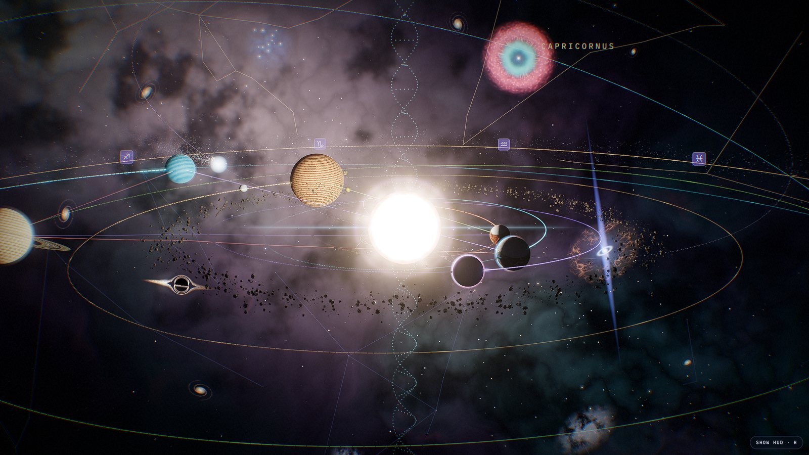
</a>

A real-time WebGL2 scene built on three.js. Six procedural worlds are lit by one 5772&nbsp;K sun, with HDR bloom, filmic tone mapping and 3,232 real stars behind them. Each world wears its zodiac sign and degree, live.

<table>
  <tr>
    <td width="50%"><a href="https://rawcdn.githack.com/windingsky9-droid/Ssushhii/577dedc7c30d6bafe16ef8f09178a832e075afe0/portfolio/demos/celestial-observatory-cinematic.html?shot=erebus">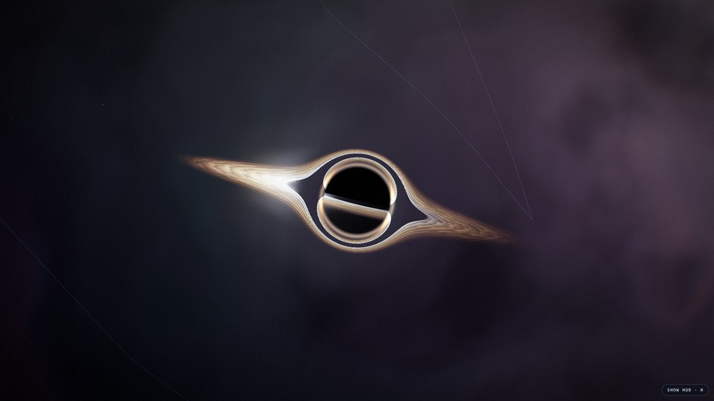</a><br><b>EREBUS.</b> A black hole whose lens bends light into a true Einstein ring.</td>
    <td width="50%"><a href="https://rawcdn.githack.com/windingsky9-droid/Ssushhii/577dedc7c30d6bafe16ef8f09178a832e075afe0/portfolio/demos/celestial-observatory-cinematic.html?shot=pulsar">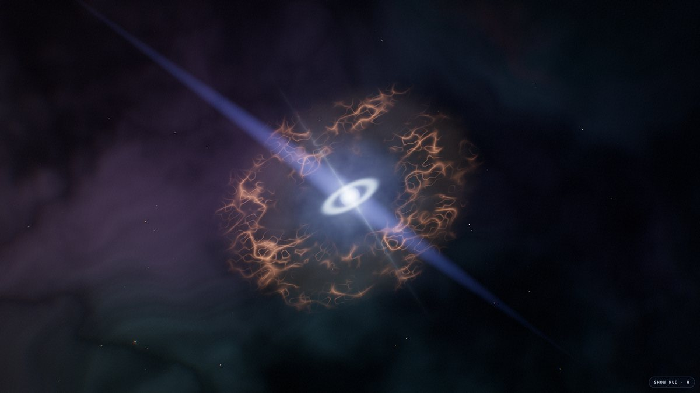</a><br><b>The pulsar.</b> It sweeps its beams past the camera inside its own nebula.</td>
  </tr>
  <tr>
    <td><a href="https://rawcdn.githack.com/windingsky9-droid/Ssushhii/577dedc7c30d6bafe16ef8f09178a832e075afe0/portfolio/demos/celestial-observatory-cinematic.html?shot=ringed">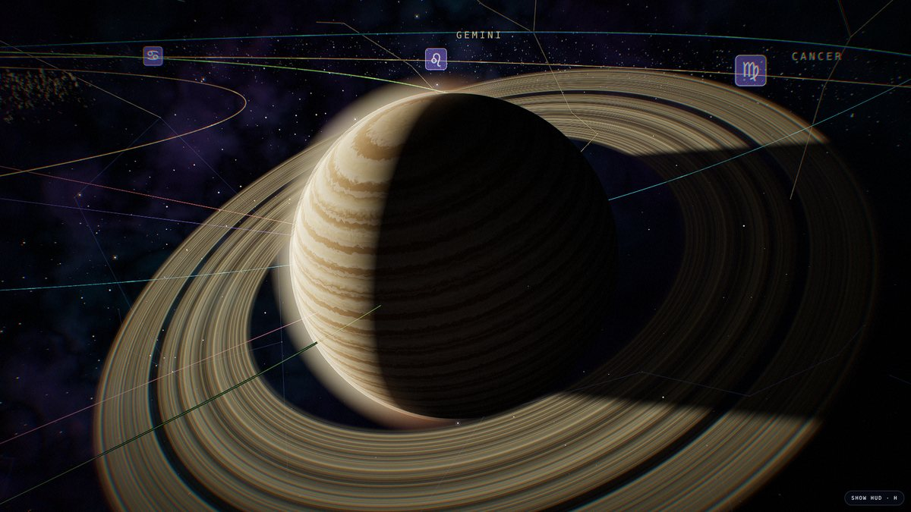</a><br><b>The ringed world.</b> One sun, real terminator, rings that catch the light.</td>
    <td><a href="https://rawcdn.githack.com/windingsky9-droid/Ssushhii/577dedc7c30d6bafe16ef8f09178a832e075afe0/portfolio/demos/celestial-observatory-cinematic.html?shot=comet">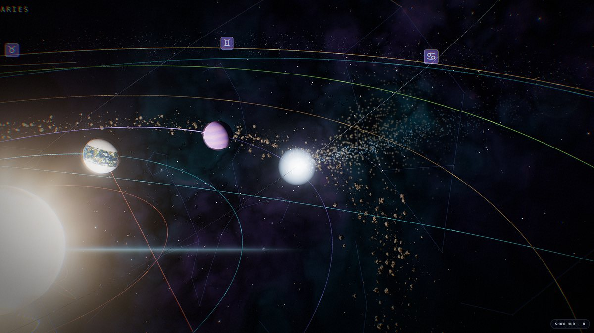</a><br><b>The comet.</b> A Keplerian comet on a real elliptical orbit.</td>
  </tr>
  <tr>
    <td><a href="https://rawcdn.githack.com/windingsky9-droid/Ssushhii/577dedc7c30d6bafe16ef8f09178a832e075afe0/portfolio/demos/celestial-observatory-cinematic.html?shot=top">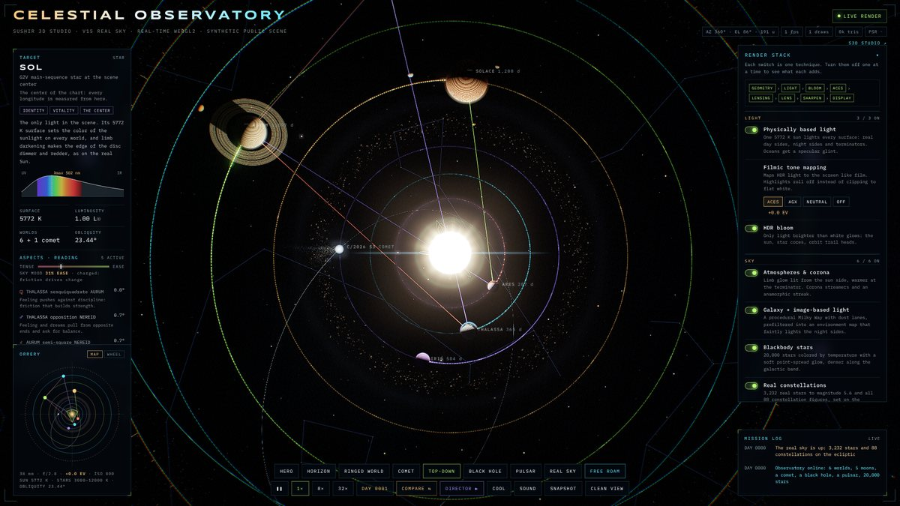</a><br><b>Top-down, with the HUD.</b> Turn each render technique off to see what it adds.</td>
    <td><a href="https://rawcdn.githack.com/windingsky9-droid/Ssushhii/577dedc7c30d6bafe16ef8f09178a832e075afe0/portfolio/demos/celestial-observatory-cinematic.html?wheel&shot=ringed">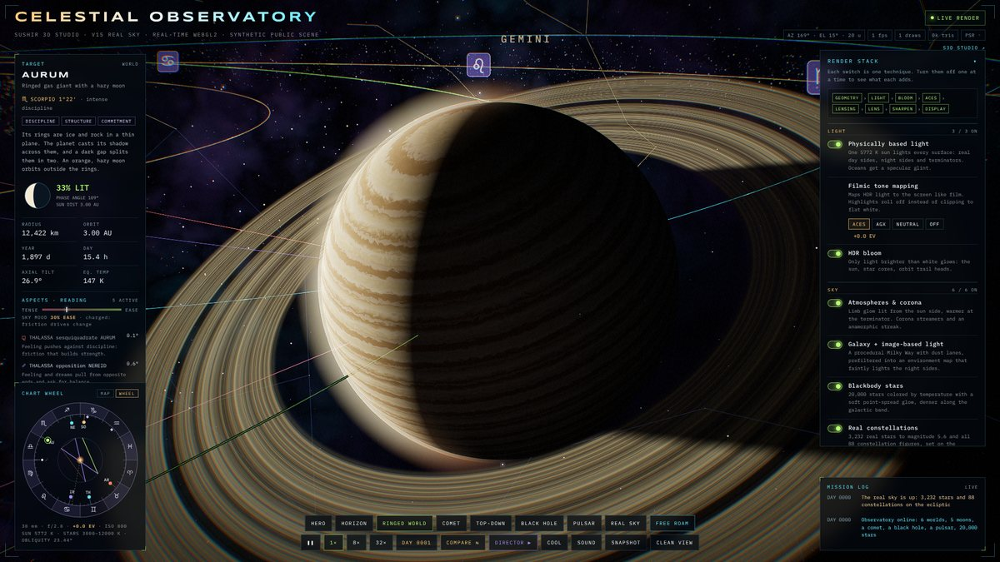</a><br><b>The chart wheel.</b> Every body shows its sign and degree, with aspect chords.</td>
  </tr>
</table>

<a href="https://rawcdn.githack.com/windingsky9-droid/Ssushhii/577dedc7c30d6bafe16ef8f09178a832e075afe0/portfolio/demos/celestial-observatory-cinematic.html?compare">
  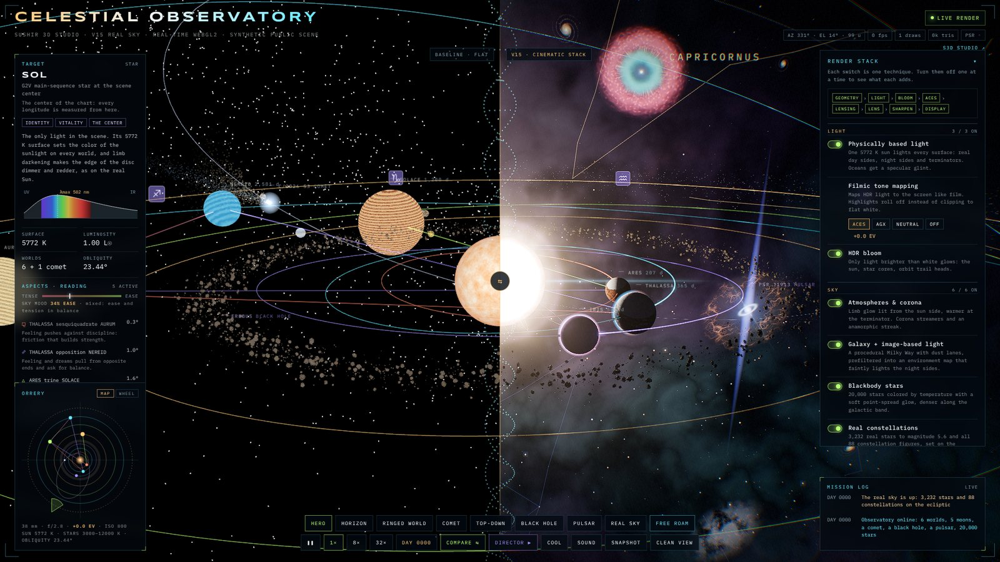
</a>

<p align="center"><sub><b>Compare mode.</b> Left: a flat render. Right: the full stack. Same scene, same frame.</sub></p>

<p align="center">
  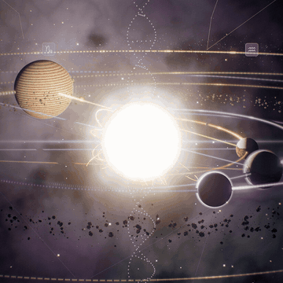
  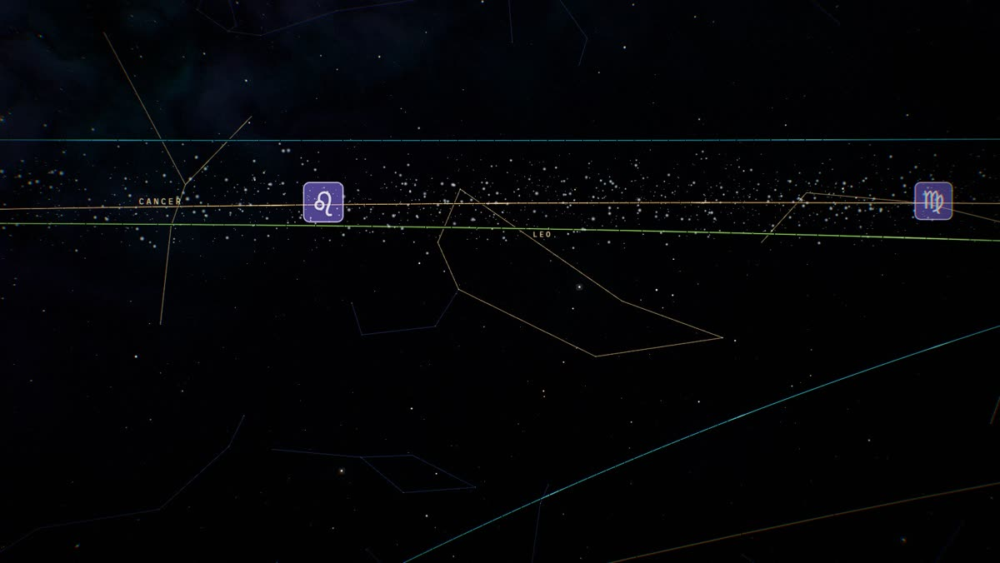
</p>

<b><a href="https://rawcdn.githack.com/windingsky9-droid/Ssushhii/577dedc7c30d6bafe16ef8f09178a832e075afe0/portfolio/demos/celestial-observatory-cinematic.html">▶ Launch it live</a></b> in your browser. Or jump straight to
<a href="https://rawcdn.githack.com/windingsky9-droid/Ssushhii/577dedc7c30d6bafe16ef8f09178a832e075afe0/portfolio/demos/celestial-observatory-cinematic.html?shot=erebus">the black hole</a>,
<a href="https://rawcdn.githack.com/windingsky9-droid/Ssushhii/577dedc7c30d6bafe16ef8f09178a832e075afe0/portfolio/demos/celestial-observatory-cinematic.html?shot=pulsar">the pulsar</a>,
<a href="https://rawcdn.githack.com/windingsky9-droid/Ssushhii/577dedc7c30d6bafe16ef8f09178a832e075afe0/portfolio/demos/celestial-observatory-cinematic.html?shot=sky">the real sky</a> or
<a href="https://rawcdn.githack.com/windingsky9-droid/Ssushhii/577dedc7c30d6bafe16ef8f09178a832e075afe0/portfolio/demos/celestial-observatory-cinematic.html?tour">the narrated tour</a>.

### Sky Wheel

<table>
  <tr>
    <td width="50%"><a href="https://rawcdn.githack.com/windingsky9-droid/Ssushhii/577dedc7c30d6bafe16ef8f09178a832e075afe0/portfolio/demos/sky-wheel.html">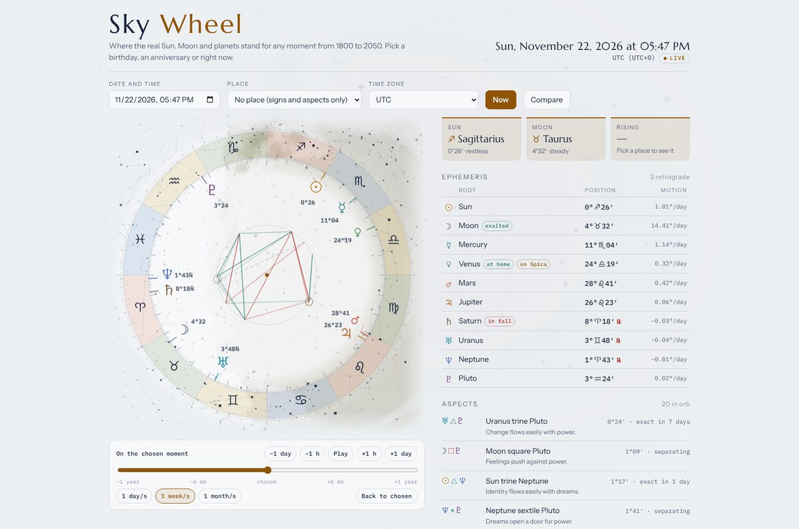</a><br><b>Today.</b> Sun, Moon and planets with signs, retrogrades and aspects.</td>
    <td width="50%"><a href="https://rawcdn.githack.com/windingsky9-droid/Ssushhii/577dedc7c30d6bafe16ef8f09178a832e075afe0/portfolio/demos/sky-wheel.html?cmp=1&d=1969-07-20T15:17&tz=America/Chicago&place=Houston&n1=Moon%20landing&n2=Today">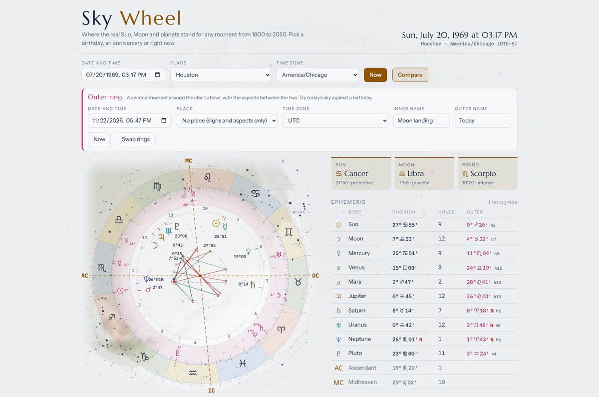</a><br><b>Compare.</b> The Moon landing, with today's sky as an outer ring.</td>
  </tr>
</table>

A chart of the real sky for any moment from 1800 to 2050, running entirely in the browser. It shows the Sun, Moon and planets through Pluto with signs, retrogrades and aspects, set against 3,232 real stars and the constellation figures. It also has a Compare mode for two moments and a 2400×3200 print poster.

Positions were checked against PyEphem at 240 dates:

| Body | RMS error |
|---|---|
| Sun | 0.006° |
| Moon | 0.028° |
| Every planet | under 0.1° |

**[▶ Open it live](https://rawcdn.githack.com/windingsky9-droid/Ssushhii/577dedc7c30d6bafe16ef8f09178a832e075afe0/portfolio/demos/sky-wheel.html)** · [Moon landing vs. today](https://rawcdn.githack.com/windingsky9-droid/Ssushhii/577dedc7c30d6bafe16ef8f09178a832e075afe0/portfolio/demos/sky-wheel.html?cmp=1&d=1969-07-20T15:17&tz=America/Chicago&place=Houston&n1=Moon%20landing&n2=Today) · [Source](https://github.com/windingsky9-droid/Ssushhii/blob/main/portfolio/demos/sky-wheel.html)

### Sushir Halo Tactical Command Center

<a href="https://rawcdn.githack.com/windingsky9-droid/Ssushhii/577dedc7c30d6bafe16ef8f09178a832e075afe0/showcase/SUSHIR_HALO_TACTICAL_COMMAND_CENTER_V12_CINEMATIC_OPERATIONS.html">
  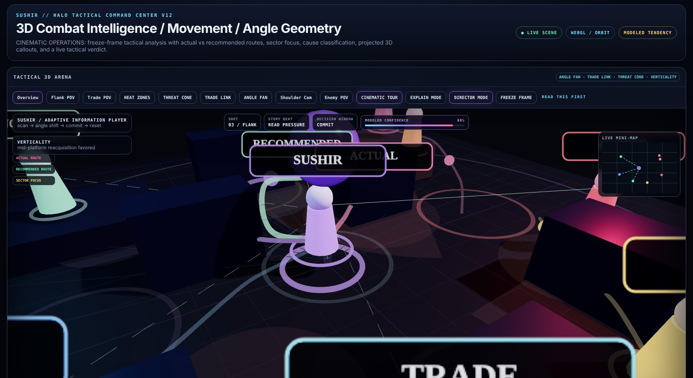
</a>

<table>
  <tr>
    <td width="33%"><br><b>V12 overview.</b> Roles, arena, mini-map, decision flow.</td>
    <td width="33%">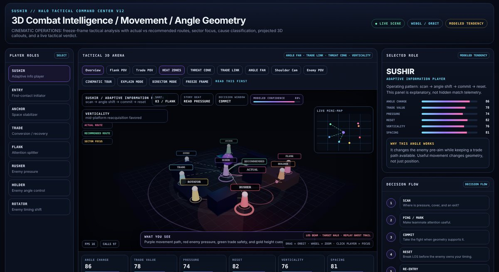<br><b>Heat zones.</b> Where the pressure actually is.</td>
    <td width="33%">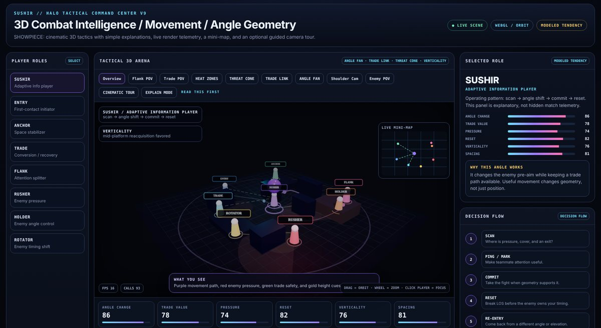<br><b>V9 showpiece.</b> Where it started looking good.</td>
  </tr>
</table>

An interactive three.js tactical visualization with camera controls, replay analysis, route overlays and a cinematic Director Mode. Tactical values are modeled demo values, not official Halo telemetry. Low-key version: **I made the angles move, then made them explain themselves.** [Open V12 live](https://rawcdn.githack.com/windingsky9-droid/Ssushhii/577dedc7c30d6bafe16ef8f09178a832e075afe0/showcase/SUSHIR_HALO_TACTICAL_COMMAND_CENTER_V12_CINEMATIC_OPERATIONS.html) · [Source](https://github.com/windingsky9-droid/Ssushhii/tree/main/showcase)

### Duo Display, path-traced in Blender

<a href="https://github.com/windingsky9-droid/Ssushhii/pull/21">
  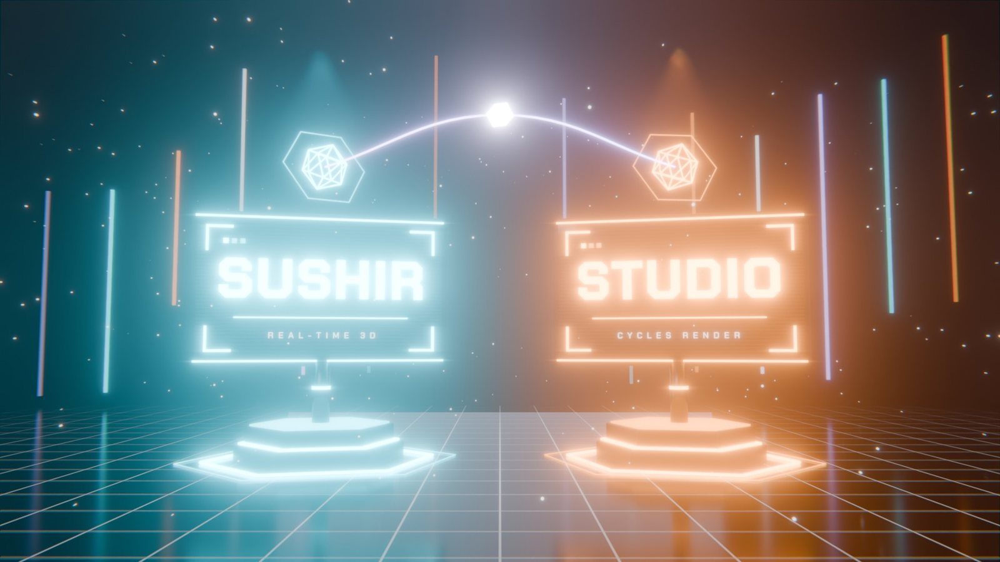
</a>

<table>
  <tr>
    <td width="62%">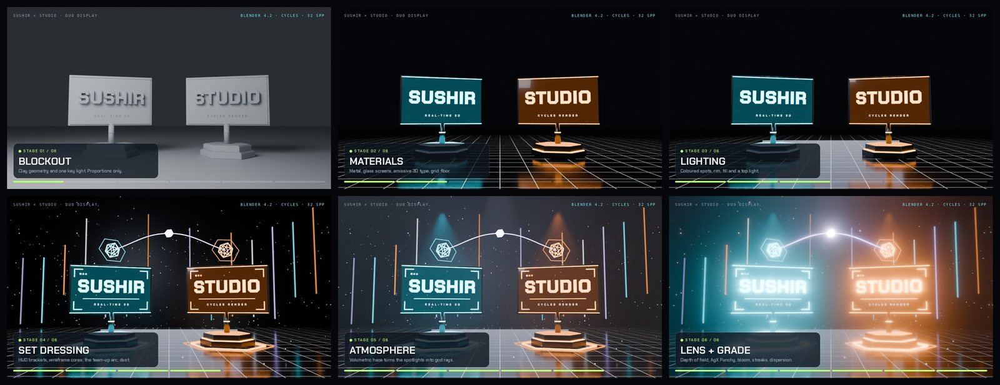<br><b>Built in six passes.</b> Clay, materials, light, set dressing, haze, lens.</td>
    <td width="38%">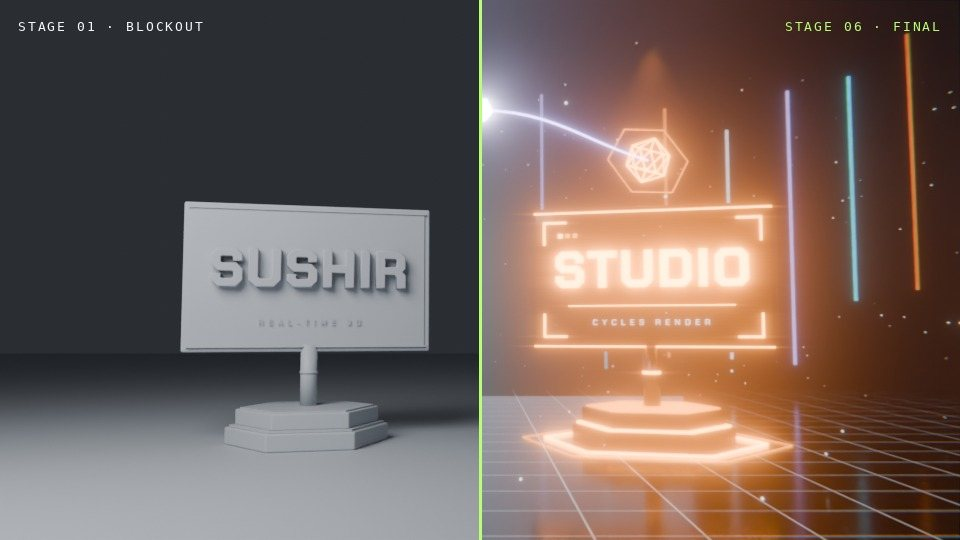<br><b>Before / after.</b> Same camera, eight minutes apart.</td>
  </tr>
</table>

My first path-traced piece. One Python script builds the whole scene in Blender 4.2 and renders it with Cycles. No hand modelling, and the two names are command-line arguments.

### Market Observatory

<a href="https://rawcdn.githack.com/windingsky9-droid/Ssushhii/577dedc7c30d6bafe16ef8f09178a832e075afe0/public-demo/index.html">
  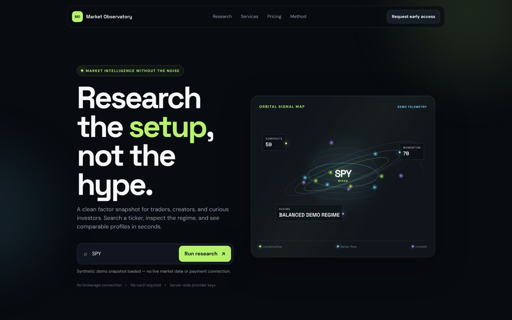
</a>

A Flask research dashboard with a provider boundary, deterministic demo data, JSON endpoints and automated tests. Demo mode runs without paid API credentials.

- 15 existing tests passed during cloud setup.
- Live health, ticker research, invalid-input and pricing checks passed.
- Desktop and mobile browser flows were verified.
- Live data providers and payment integrations are optional; the verified demo uses synthetic data.

### The studio site, and the shop

<table>
  <tr>
    <td width="34%"><a href="https://rawcdn.githack.com/windingsky9-droid/Ssushhii/577dedc7c30d6bafe16ef8f09178a832e075afe0/portfolio/index.html">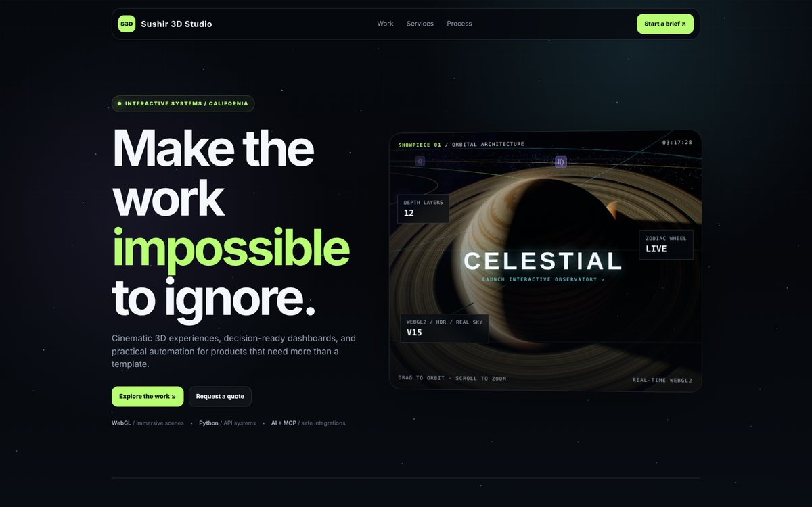</a><br><b>Sushir 3D Studio.</b> One page, two live WebGL demos.</td>
    <td width="33%">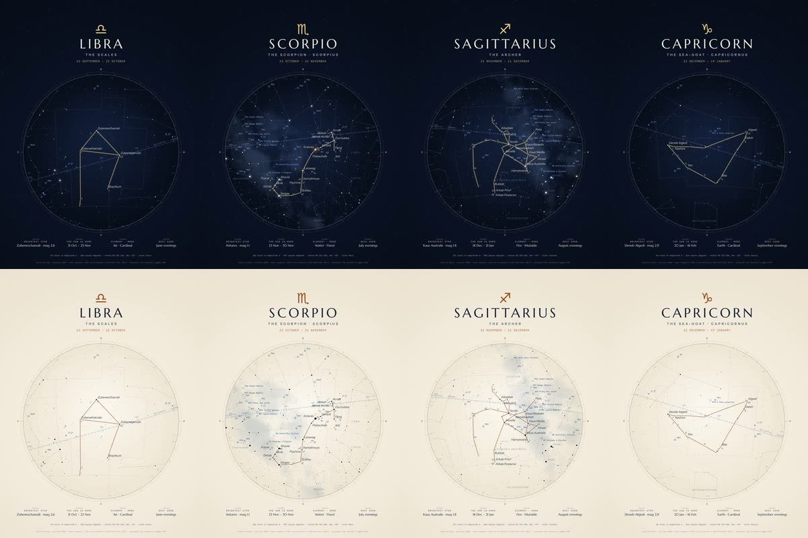<br><b>12 zodiac star-map prints.</b> Real star positions, 3600×4800.</td>
    <td width="33%">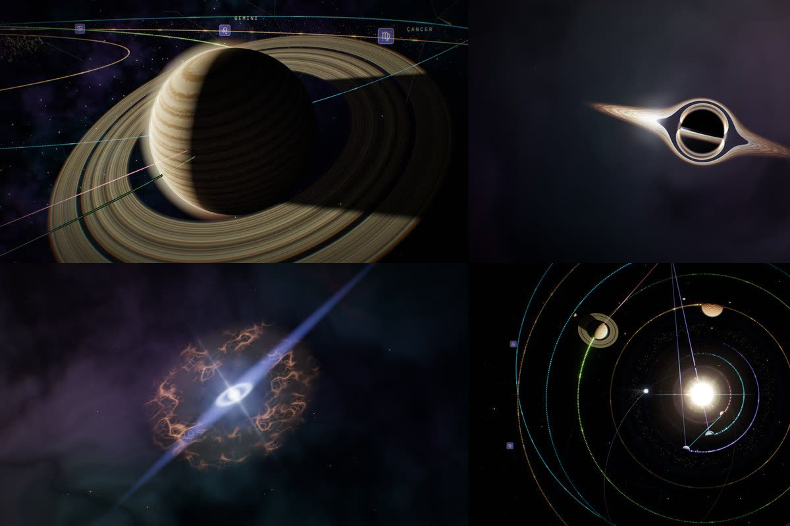<br><b>Observatory wallpaper pack.</b> Eight scenes, desktop and phone.</td>
  </tr>
</table>

The prints and wallpapers are finished. The checkout isn't set up yet, which is very on brand for a developer.

## Still cooking

<a href="https://github.com/windingsky9-droid/Ssushhii/pull/20">
  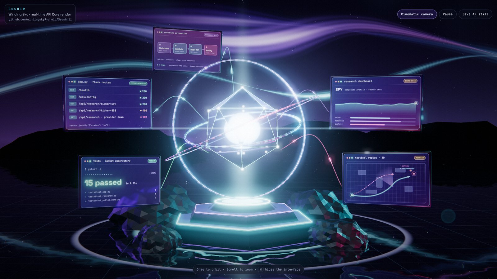
</a>

<table>
  <tr>
    <td width="33%"><a href="https://github.com/windingsky9-droid/Ssushhii/pull/5">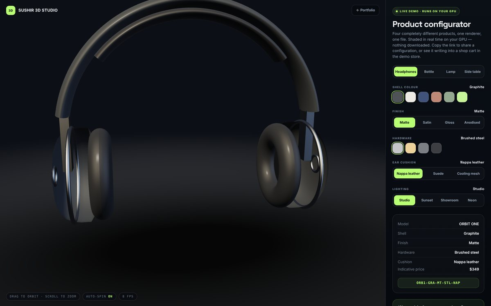</a><br><b>3D product configurator.</b> Pick colours, see it live.</td>
    <td width="33%"><a href="https://github.com/windingsky9-droid/Ssushhii/pull/5">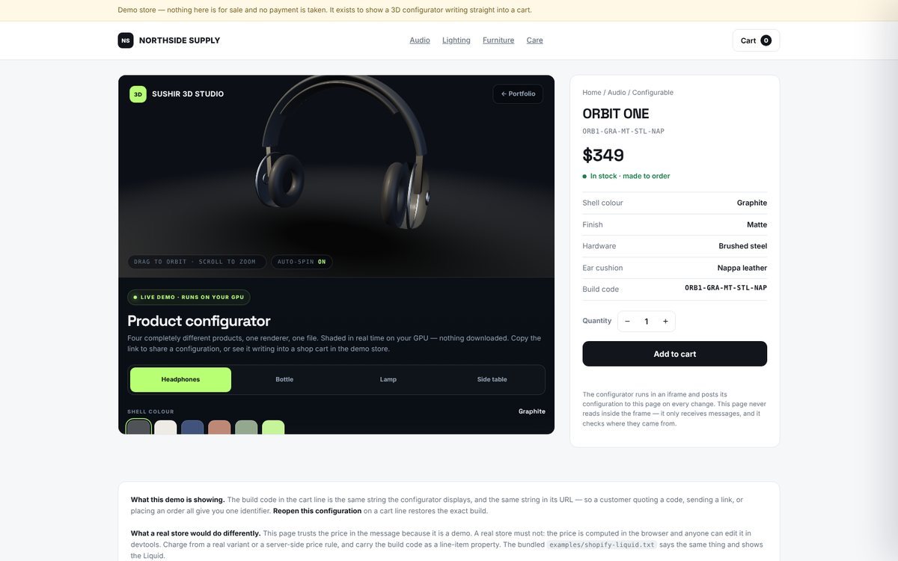</a><br><b>Store demo.</b> The same configurator inside a shop page.</td>
    <td width="33%"><a href="https://github.com/windingsky9-droid/Ssushhii/pull/6">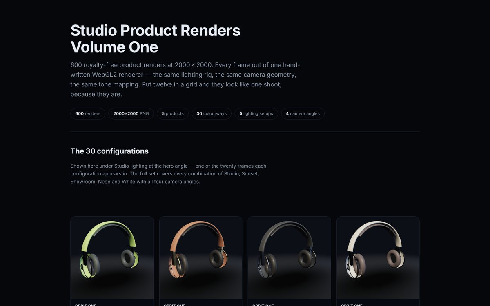</a><br><b>Product renders, vol. 1.</b> 600 renders from one WebGL rig.</td>
  </tr>
  <tr>
    <td><a href="https://github.com/windingsky9-droid/Ssushhii/pull/8">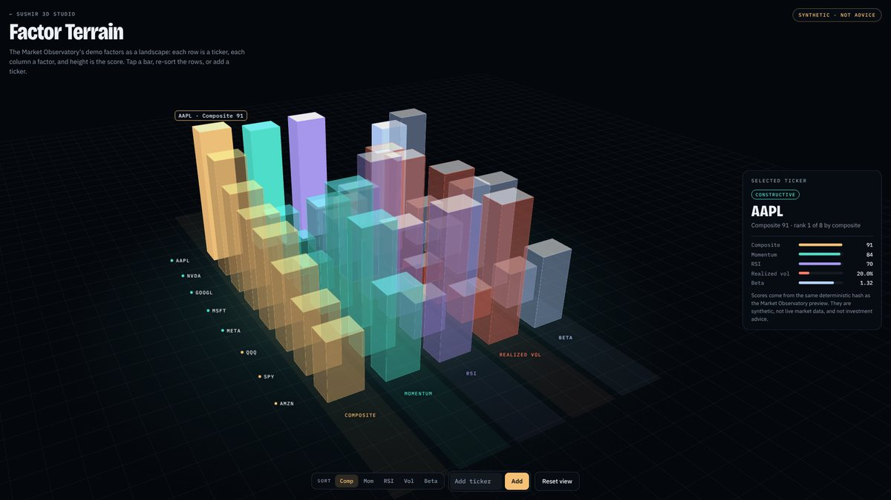</a><br><b>Factor Terrain.</b> Market factors as a 3D landscape.</td>
    <td><a href="https://github.com/windingsky9-droid/Ssushhii/pull/6">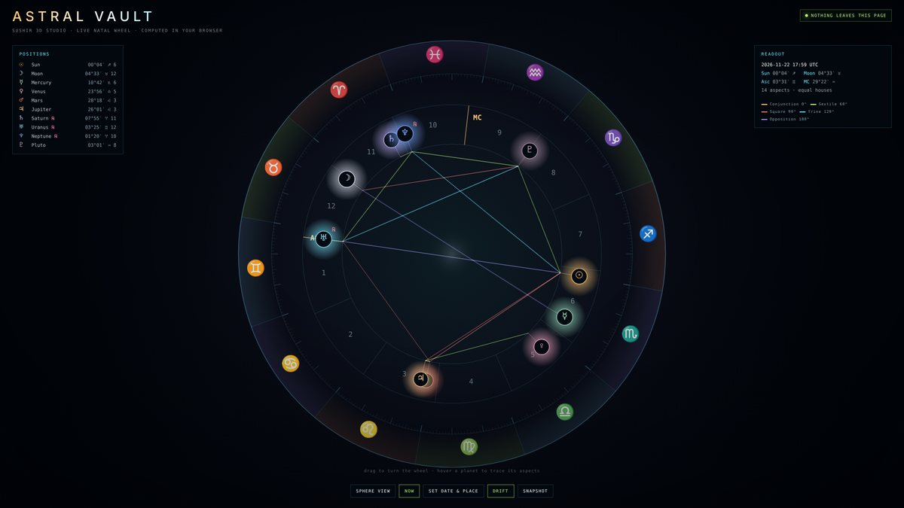</a><br><b>Astral Vault.</b> A birth-chart wheel you can explore.</td>
    <td><a href="https://github.com/windingsky9-droid/Ssushhii/pull/10">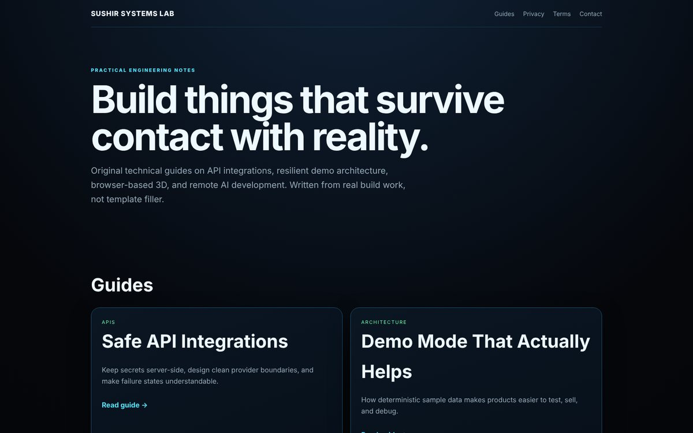</a><br><b>Publisher site.</b> Guides on APIs, demo mode and WebGL.</td>
  </tr>
</table>

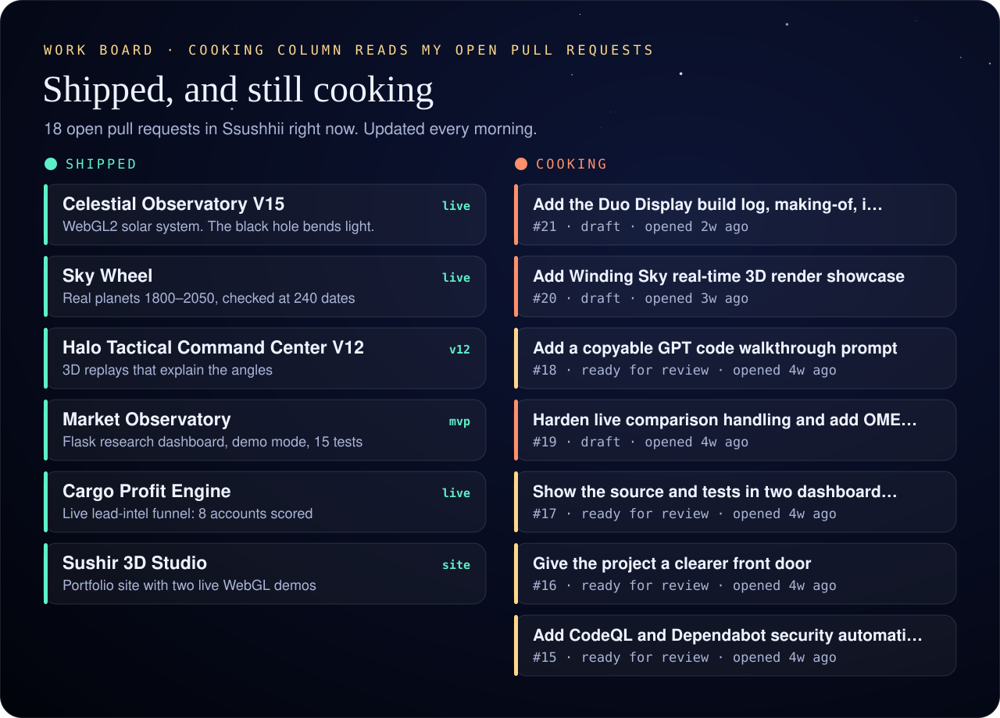

## Code I'm proud of

Short excerpts from the projects above. The real files are linked under each one.

**Bending light around a black hole.** A point lens maps every pixel at angle θ to the source at θ − θE²/θ. That one line is the Einstein ring.

```glsl
// gravitational lens: a point lens maps each pixel at angle θ to the source at θ − θE²/θ
vec2 uv = vUv; float hole = 1.0, ring = 0.0;
if (uBH.z > 0.5) {
  vec2  d   = (vUv - uBH.xy) * vec2(uAspect, 1.0);
  float r   = max(length(d), 1e-5), rE = uBHr;
  float win = smoothstep(rE * 16.0, rE * 4.0, r);              // fade the lens in near the hole
  uv   = uBH.xy + d / r * mix(r, r - rE * rE / r, win) / vec2(uAspect, 1.0);
  float rs = rE * 0.74;                                        // the shadow
  hole = smoothstep(rs * 0.965, rs * 1.035, r);
  ring = exp(-pow((r - rs * 1.08) / (rE * 0.045), 2.0));       // the Einstein ring
}
```
<sub>From <a href="https://github.com/windingsky9-droid/Ssushhii/blob/main/portfolio/demos/celestial-observatory-cinematic.html">celestial-observatory-cinematic.html</a></sub>

**Where is Saturn, really?** The Sky Wheel solves Kepler's equation with Newton's method, then turns JPL's orbital elements into a position.

```js
// Newton's method on Kepler's equation: E − e·sin(E) = M
const kepler = (M, e) => {
  let E = M + e * Math.sin(M);
  for (let i = 0; i < 12; i++) {
    const d = (E - e * Math.sin(E) - M) / (1 - e * Math.cos(E));
    E -= d;
    if (Math.abs(d) < 1e-12) break;
  }
  return E;
};

function helio(name, T) {                 // T = Julian centuries since J2000
  const [b, r] = EL[name];                // JPL elements and their rates per century
  const a = b[0] + r[0] * T, e = b[1] + r[1] * T, I = (b[2] + r[2] * T) * D2R;
  const L = b[3] + r[3] * T, wb = b[4] + r[4] * T, O = b[5] + r[5] * T;
  const w = (wb - O) * D2R, Om = O * D2R, M = norm(L - wb) * D2R;
  const E = kepler(M > Math.PI ? M - 2 * Math.PI : M, e);
  const xp = a * (Math.cos(E) - e), yp = a * Math.sqrt(1 - e * e) * Math.sin(E);
  // ...then rotate from the orbit's own plane into the ecliptic
}
```
<sub>From <a href="https://github.com/windingsky9-droid/Ssushhii/blob/main/portfolio/demos/sky-wheel.html">sky-wheel.html</a></sub>

**A demo mode that never pretends.** Same ticker, same numbers, every time: a hash, not a random number. The page labels it as demo data, so nobody mistakes it for a live quote.

```python
class ResearchProvider(Protocol):
    def research(self, ticker: str) -> dict[str, Any]: ...


class DemoResearchProvider:
    def _score(self, ticker: str, salt: str, low: int, high: int) -> int:
        digest = hashlib.sha256(f"{ticker}:{salt}".encode()).digest()
        return low + int.from_bytes(digest[:2], "big") % (high - low + 1)

    def research(self, ticker: str) -> dict[str, Any]:
        ticker = normalize_ticker(ticker)
        composite = self._score(ticker, "composite", 38, 92)
        posture = "Constructive" if composite >= 70 else "Mixed" if composite >= 50 else "Defensive"
        return {"ticker": ticker, "source": "demo", "source_label": "Deterministic demo data", ...}
```
<sub>From <a href="https://github.com/windingsky9-droid/Ssushhii/blob/main/src/research.py">src/research.py</a></sub>

**This page's own sky.** Every morning a GitHub Action asks where everything is, then draws the wheel at the top of this page.

```python
def lon(body, t):
    if body == ae.Body.Sun:
        return ae.SunPosition(t).elon % 360
    if body == ae.Body.Moon:
        return ae.EclipticGeoMoon(t).lon % 360
    return ae.Ecliptic(ae.GeoVector(body, t, True)).elon % 360

speed = signed(lon(body, t.AddDays(0.5)) - lon(body, t.AddDays(-0.5)))
retrograde = speed < 0   # the planet looks like it's moving backwards
```
<sub>From <a href="scripts/sky_today.py">scripts/sky_today.py</a></sub>

## Chess

<a href="https://www.chess.com/member/windingsky">
  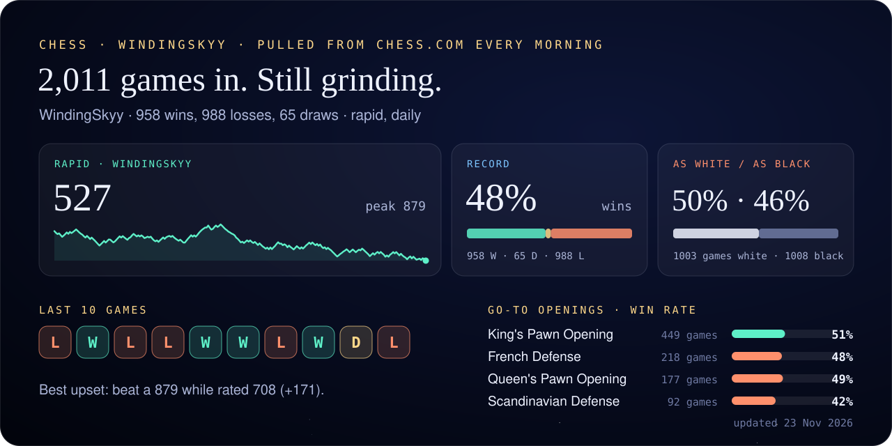
</a>

## What I can help with

- Diagnose small Flask and REST endpoint issues.
- Connect documented APIs and handle errors clearly.
- Build focused dashboards and internal tools.
- Explore bounded AI/MCP integrations.
- Create browser-based visualization prototypes, from a chart to a full 3D scene.

## Start a conversation

[Open a service brief](https://github.com/windingsky9-droid/Ssushhii/issues/new?template=service-request.yml) with your goal, expected behavior and relevant constraints. Please leave passwords and API keys out of public issues.

Small Flask/API fixes can start at **$40 USD**, subject to confirming the exact issue and scope first.

<sub>This profile redraws its sky, chess card and work board every morning. The scripts live in <a href="scripts">scripts/</a>, and the header is a real three.js scene rendered frame by frame.</sub>
