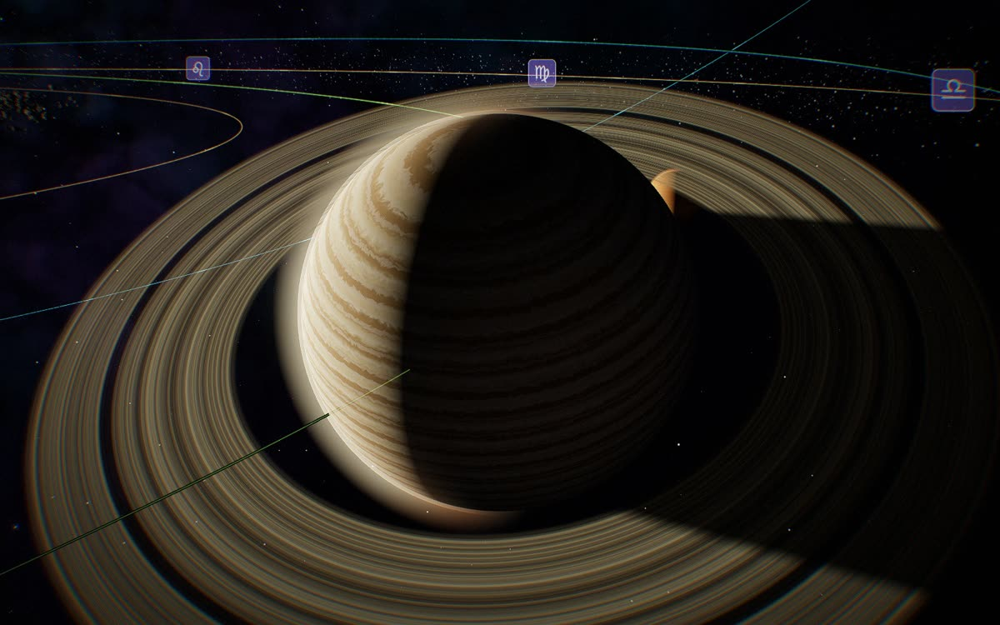
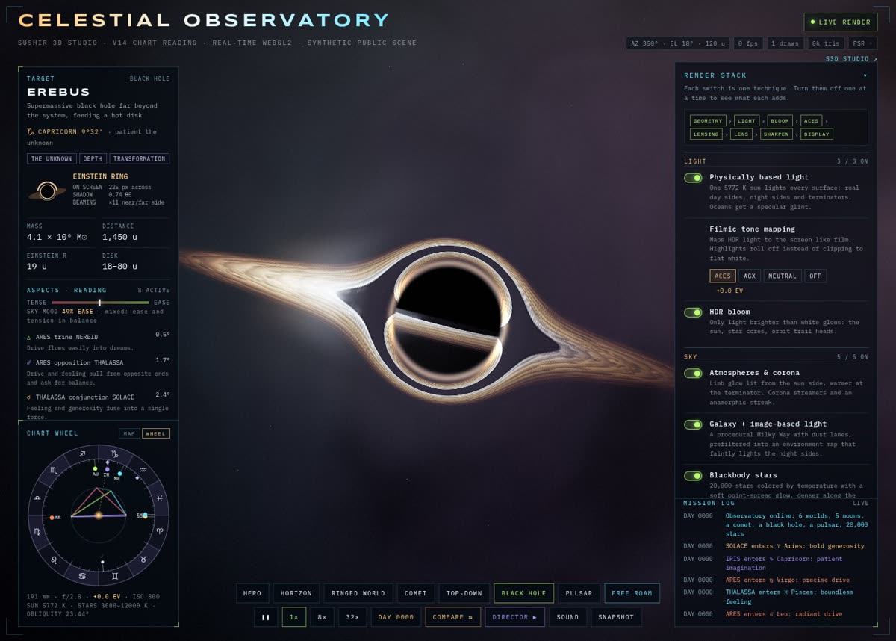
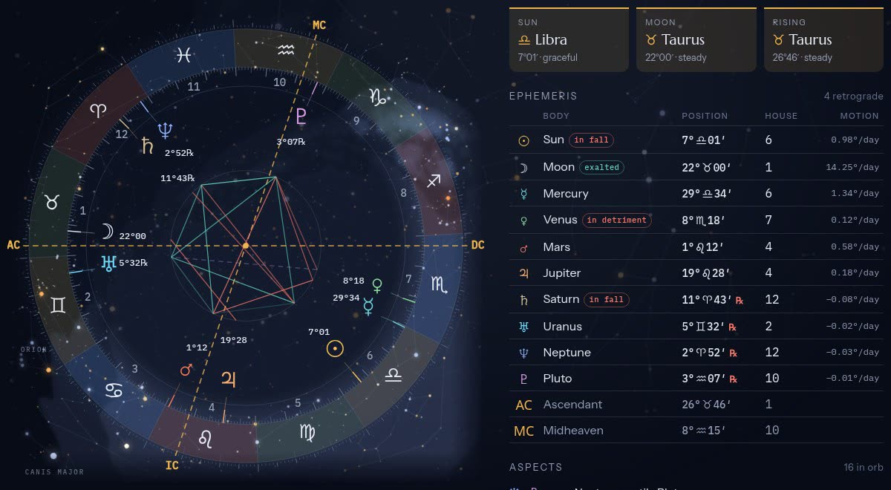
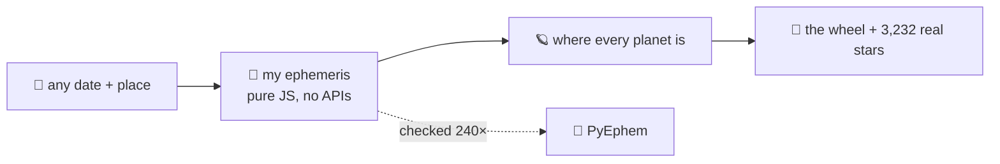
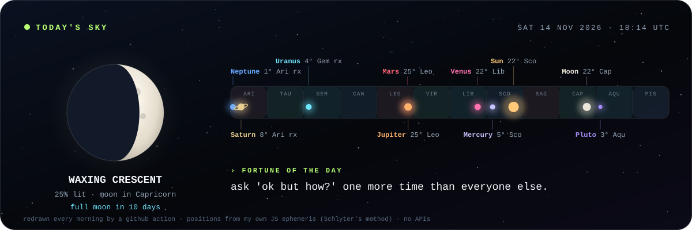

  <a href="https://rawcdn.githack.com/windingsky9-droid/Ssushhii/577dedc7c30d6bafe16ef8f09178a832e075afe0/portfolio/demos/celestial-observatory-cinematic.html"><b>▶ fly through my observatory</b></a> &nbsp;·&nbsp;
  <a href="https://rawcdn.githack.com/windingsky9-droid/Ssushhii/577dedc7c30d6bafe16ef8f09178a832e075afe0/portfolio/demos/sky-wheel.html"><b>▶ spin the sky wheel</b></a> &nbsp;·&nbsp;
  <a href="https://sushir-3d-studio.floot.app">my studio</a> &nbsp;·&nbsp;
  <a href="https://rawcdn.githack.com/windingsky9-droid/Ssushhii/577dedc7c30d6bafe16ef8f09178a832e075afe0/portfolio/index.html">portfolio</a> &nbsp;·&nbsp;
  <a href="https://github.com/windingsky9-droid/Ssushhii/issues/new?template=service-request.yml">hire me</a>
    
  

### hey, i'm sushir. sushi for short.

i build stuff you can **fly through**: real-time 3D, live star charts, and little machines that explain themselves. 
self-taught. i came up picking orders in warehouses and taught myself to code by building the things i wanted to stare at. 
i learn in pictures. if i can't see it, i don't get it, so i build the picture first.

> [!TIP]
> **open to work:** AI automation · implementation · solutions engineering · creative / data-viz dev. remote is perfect.
> [let's talk →](https://github.com/windingsky9-droid/Ssushhii/issues/new?template=service-request.yml)

## stuff i built 🛰️

<table>
  <tr>
    <td width="58%" valign="top">
      
    </td>
    <td valign="top">
      <h3>celestial observatory</h3>
      <b>in plain words:</b> a little universe in your browser. six planets, one sun, 3,232 real stars, and a black hole you can fly up to.  
      <b>the hard part:</b> making <b>EREBUS</b>, the black hole, bend light into a real Einstein ring while everything still runs live.  
      <a href="https://rawcdn.githack.com/windingsky9-droid/Ssushhii/577dedc7c30d6bafe16ef8f09178a832e075afe0/portfolio/demos/celestial-observatory-cinematic.html"><b>▶ launch it</b></a> · jump to
      <a href="https://rawcdn.githack.com/windingsky9-droid/Ssushhii/577dedc7c30d6bafe16ef8f09178a832e075afe0/portfolio/demos/celestial-observatory-cinematic.html?shot=erebus">the black hole</a>,
      <a href="https://rawcdn.githack.com/windingsky9-droid/Ssushhii/577dedc7c30d6bafe16ef8f09178a832e075afe0/portfolio/demos/celestial-observatory-cinematic.html?shot=pulsar">the pulsar</a>,
      <a href="https://rawcdn.githack.com/windingsky9-droid/Ssushhii/577dedc7c30d6bafe16ef8f09178a832e075afe0/portfolio/demos/celestial-observatory-cinematic.html?shot=sky">the real sky</a> or
      <a href="https://rawcdn.githack.com/windingsky9-droid/Ssushhii/577dedc7c30d6bafe16ef8f09178a832e075afe0/portfolio/demos/celestial-observatory-cinematic.html?tour">the narrated tour</a>
    </td>
  </tr>
</table>

  
  
  

### [sky wheel](https://rawcdn.githack.com/windingsky9-droid/Ssushhii/577dedc7c30d6bafe16ef8f09178a832e075afe0/portfolio/demos/sky-wheel.html)

**in plain words:** pick any moment from 1800 to 2050 and see exactly where the sun, moon and every planet were, on top of the real constellations. it has a compare mode for two moments and makes a 2400×3200 print poster.

**the hard part:** being *right*. here's how it works:

**[▶ open it](https://rawcdn.githack.com/windingsky9-droid/Ssushhii/577dedc7c30d6bafe16ef8f09178a832e075afe0/portfolio/demos/sky-wheel.html)** · [moon landing vs. today](https://rawcdn.githack.com/windingsky9-droid/Ssushhii/577dedc7c30d6bafe16ef8f09178a832e075afe0/portfolio/demos/sky-wheel.html?cmp=1&d=1969-07-20T15:17&tz=America/Chicago&place=Houston&n1=Moon%20landing&n2=Today) · [source](https://github.com/windingsky9-droid/Ssushhii/blob/main/portfolio/demos/sky-wheel.html)

 

### [halo tactical command center](https://github.com/windingsky9-droid/Ssushhii/tree/main/showcase)

**in plain words:** a 3D war room for Halo matches: replay a round, see the routes, and hit director mode for the cinematic cut. 
tactical values are modeled demo values, not official Halo telemetry.

### [market observatory](https://github.com/windingsky9-droid/Ssushhii)

**in plain words:** a stock research dashboard you can try for free, because demo mode runs on built-in sample data. 
**the boring-but-important part:** a clean provider boundary, JSON endpoints, 15 automated tests on every push, and desktop + mobile checked in a real browser.

## proof, not vibes 📏

| what | the number | how i checked |
|---|---|---|
| sun position | **0.006°** RMS error | vs PyEphem at 240 dates |
| moon position | **0.028°** RMS error | same test |
| every planet | **under 0.1°** | same test |
| birth-chart engine | **≤ 0.16°** off | vs independently verified charts |
| 3D detail pass | **98 → 148** meshes | framerate unchanged |
| market observatory | **15 / 15** tests | pytest in CI on every push |

## today's sky 🌙

a GitHub Action wakes up every morning, runs my own ephemeris (pure JS, no APIs) and redraws this card. come back tomorrow: new moon phase, new fortune.

<b>🌀 click for silly mode</b>

 

- **"sushir"** started as a halo reach roleplay name. i played a saxon. my friends never let it go.
- i'm credited as a **forger** on halo waypoint's *Forge Features*. i build maps when i'm not building skies.
- **76% headshots** in halo infinite, last time i checked. my css is less accurate.
- i own a **blue '03 strat**. it has spent more time in pieces than my side projects.
- my monitor does **320hz**. my shaders do 60fps. we don't talk about it.
- i think out loud. half my best code started as me talking to myself.
- favorite debugging move: turn the bug into a 3D scene so i can actually *see* it.
- i once checked planet positions against an astronomy library 240 times. for fun.

## in the lab 🧪

- **forward pass:** a neural net you can watch think, in 3D. every layer lights up as it decides.
- **two skies:** two people's birth charts as glowing 3D rings, with a thread for every connection between them.
- **today's sky, but huge:** the card above, as a full live scene.

## hire me for small stuff 🔧

- **flask / REST API fixes** from **$40**, once we confirm the exact issue → [open a brief](https://github.com/windingsky9-droid/Ssushhii/issues/new?template=service-request.yml)
- **n8n automations:** your apps talking to each other so the boring stuff runs itself
- **a chart, a dashboard, or a whole 3D scene** for your data

made at 2am with a 320hz monitor and way too many tabs open. thanks for scrolling this far 🫡

